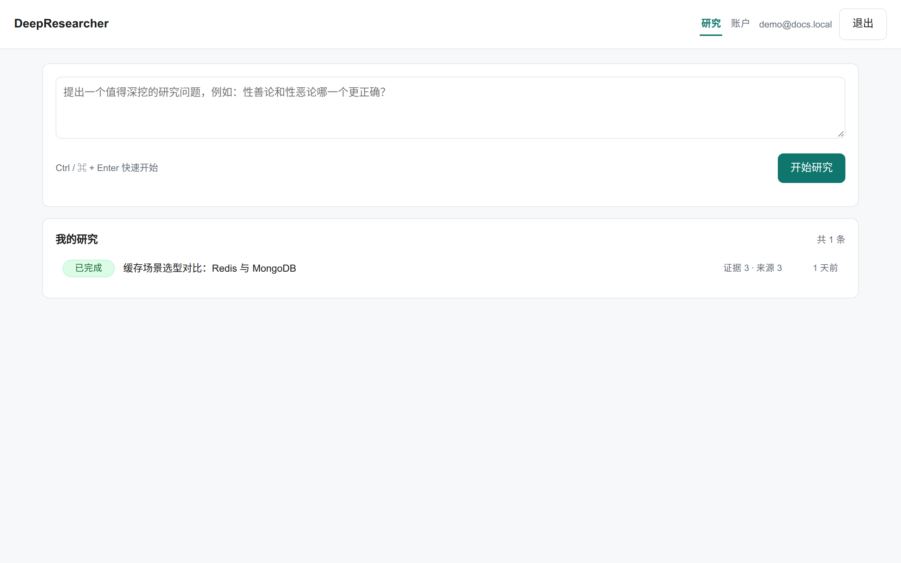
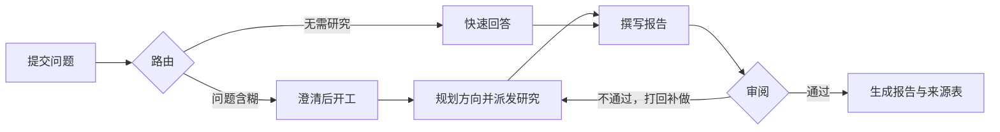
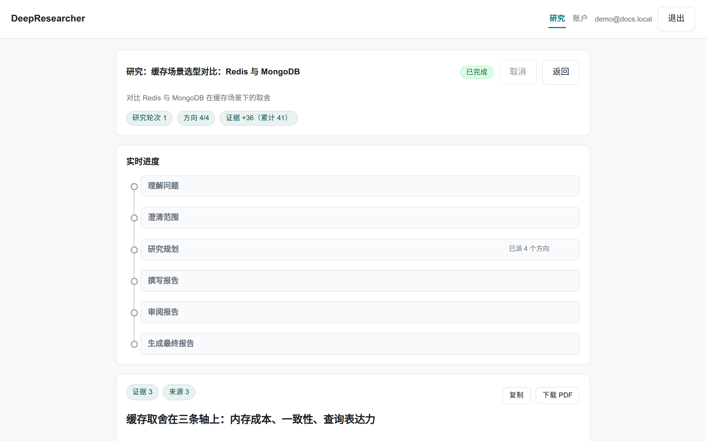
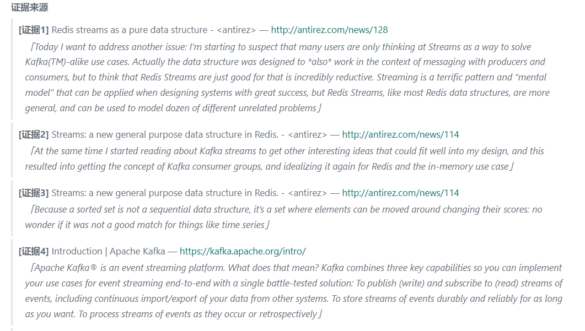
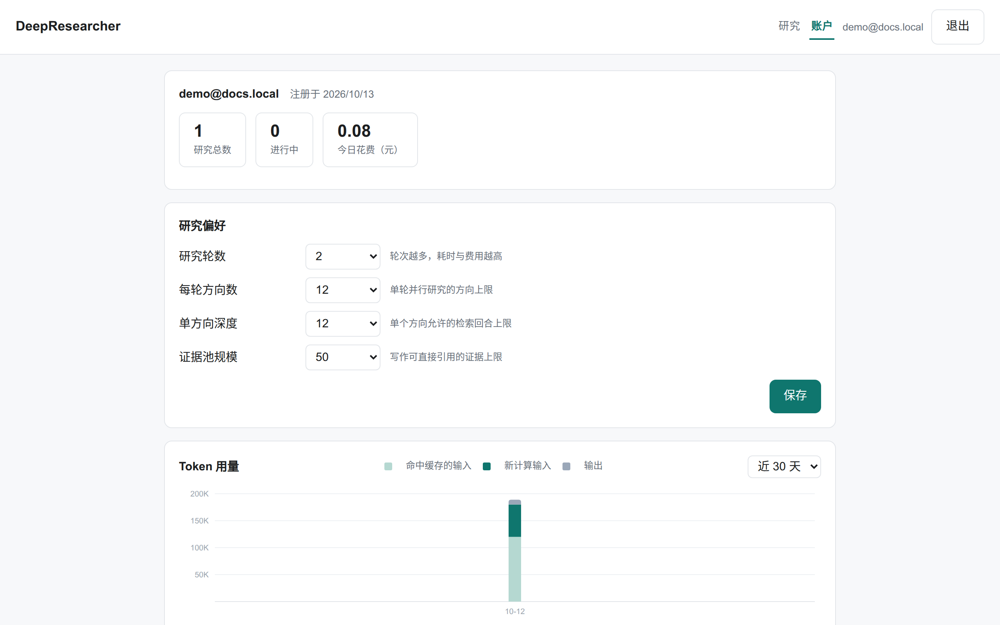

# DeepResearcher

[](https://github.com/Zi-Lan-Cui/deepresearcher/actions/workflows/quality.yml) [](LICENSE) [](pyproject.toml)

可部署的深度研究服务。围绕复杂问题自动完成检索、精读、证据校验与撰写审阅，交付论点明确的研究报告，每条结论都能追到原文核对。

[快速开始](#快速开始) · [运作方式](#运作方式) · [使用](#使用) · [配置](#配置) · [开发](#开发)



## 特性

- **结论可核对**：正文结论附引用编号，文末来源表逐条列出标题、链接与原文摘录，逐字比对一致后才采用。
- **内容有组织**：报告围绕一条核心主张展开，各章依次论证；交付的是结论，不是资料汇总。
- **费用可控制**：研究深度、每轮方向数与证据池规模在创建时确定，执行中不再变更；单次研究可另设 token 与费用上限。
- **异步不等待**：研究方向并行推进，总耗时由最慢的方向决定；任务在服务端执行，关闭页面不影响进度，服务重启后从中断处继续。

## 快速开始

用 Docker Compose 可以一键启动。本机开发需要 Python ≥ 3.12 和 [uv](https://docs.astral.sh/uv/)。

```bash
git clone https://github.com/Zi-Lan-Cui/deepresearcher.git
cd deepresearcher
cp env/.env.example env/.env   # 填入模型配置 LLM_API_KEY / LLM_BASE_URL / LLM_MODEL_ID，
                               # OpenAI 兼容接口均可。再填至少一个搜索服务：百度 / Tavily / SerpAPI / 阿里云
docker compose up -d --build   # 一次拉起 API、Worker、Postgres 和 Redis
```

打开 <http://localhost:8080> 注册账号并提交一个研究问题。详情页随研究推进逐阶段更新，研究结束后报告直接呈现在页面。研究轮数、预算与流式预览等可调项见 [env/.env.example](env/.env.example)。

开发模式下应用跑在宿主机上，日志和进程输出都直接可见：

```bash
docker compose up -d postgres redis   # 只启动 Postgres 和 Redis
uv sync
uv run deepresearcher-api             # Web 服务，开在终端 1
uv run deepresearcher-worker          # 研究执行进程，开在终端 2
```

## 运作方式

一次研究请求按以下环节推进。审阅未通过会打回重做，直到通过或达到轮数上限。



研究环节内部，每个方向先检索，再逐篇精读原文，摘出的证据与原文逐字比对通过后才进入证据池。

## 使用

### 网页

注册登录后输入问题。问题不够明确时，系统先给出一组澄清选项，回答后开始研究。详情页显示当前阶段、各研究方向的进展与证据池规模。



完成后直接阅读报告、复制或导出 PDF。正文结论后的编号对应文末来源表的一项，点开即见原文摘录：



账户页可按账号设定研究轮数、每轮方向数、单方向深度与证据池规模，并逐日呈现 token 用量与花费，缓存命中与新计算的用量分开显示：



### API

服务本身是一组普通 HTTP 接口，网页只是第一个客户端：

```bash
# 注册并获取访问令牌
TOKEN=$(curl -s -X POST http://127.0.0.1:8080/api/register \
  -H 'Content-Type: application/json' \
  -d '{"email":"me@example.com","password":"<好密码>"}' | jq -r .token)

# 提出研究问题，接口返回任务 id，研究转入后台执行
curl -s -X POST http://127.0.0.1:8080/api/runs \
  -H "Authorization: Bearer $TOKEN" -H 'Content-Type: application/json' \
  -d '{"query":"对比 Redis 与 MongoDB 在缓存场景下的取舍"}'

# 进度与结果：SSE 事件流依次推送阶段、检索、证据计数，直到 done
curl -N http://127.0.0.1:8080/api/runs/<run_id>/events \
  -H "Authorization: Bearer $TOKEN"
```

另有 `GET /api/runs` 历史列表、`POST /api/runs/{id}/resume` 回答澄清、`POST /api/runs/{id}/cancel` 取消。

## 配置

完整配置项见 [env/.env.example](env/.env.example)，下面列出最常用的几项：

| 配置项 | 作用 | 必填 | 默认 |
|---|---|---|---|
| `LLM_API_KEY` / `LLM_BASE_URL` / `LLM_MODEL_ID` | 模型服务，OpenAI 兼容接口均可 | 是 | 无 |
| `BAIDU_API_KEY` 或 `TAVILY_API_KEY` 或 `SERPAPI_API_KEY` | 搜索服务，至少配一个 | 是 | 无 |
| `SERVICE_JWT_SECRET` | 登录令牌签名 | 正式部署必填 | 本地可留空，重启后需重新登录 |
| `AGENT_MAX_RESEARCH_ROUNDS` | 研究轮数上限 | 否 | 2 |
| `SERVICE_MAX_CONCURRENT_RUNS_PER_USER` | 单个用户同时进行的研究数 | 否 | 2 |
| `LLM_MAX_TOKENS_PER_RUN` / `LLM_MAX_COST_CNY_PER_RUN` | 单次研究的 token 与花费上限，花费以人民币元计 | 否 | 0，不限制 |
| `SERVICE_RUN_TRACE_RETENTION_DAYS` | 已完成研究的过程数据保留天数，报告不受影响 | 否 | 14 |
| `LANGFUSE_PUBLIC_KEY` / `LANGFUSE_SECRET_KEY` / `LANGFUSE_BASE_URL` | 调用链与耗时观测 | 否 | 缺任一即关闭 |

模型花费由内置价表 `src/deepresearcher/pricing.py` 按人民币折算。接入新模型时在表里补一行价格即可。没有价格的模型照常记录用量，成本一栏留空。

## 项目结构

```
Dockerfile                应用镜像，API 与 Worker 共用，由 compose 编排
src/deepresearcher/
├── graph.py、nodes/、routing.py   LangGraph 流水线：路由→澄清→规划→写作→审阅
├── agents/               supervisor、researcher、writer 等角色各自的工具、状态与子图
├── service/              API、worker、队列、持久化、事件流与前端
├── observability/        事件记录、OTel 引擎与运行日志
├── prompts/              各角色的系统提示词，外置成 Markdown
└── evidence/、reporting/、schemas/   证据模型、引用校验与渲染、数据契约
tests/                    单元与集成测试，运行 make test
evals/                    基于 DRB RACE 口径的质量评测，见 evals/README.md
docker/、docker-compose.yml         本地依赖与可选的自建观测栈
env/.env.example          全部配置项与注释
```

服务只有一种运行方式。API 受理任务，worker 消费执行，两者的状态只落在数据库，worker 可以随时增减或重启。

## 开发

```bash
make quality          # lint、类型、测试、覆盖率，CI 每次推送跑同一套
make verify-service   # 实际启动 API 与 worker 两个进程做集成验证，不产生模型费用
```

提交前跑一遍 `make quality` 即可。测试不依赖外部网络。

## 贡献

项目处于个人快速迭代期，暂无正式的贡献流程。遇到问题请开 issue，附上复现步骤和 `run_id` 更容易定位。文档和测试的改进可以直接提 PR，合并前需要通过 `make quality`。

## 许可

[MIT](LICENSE) © 2026 Zi-Lan-Cui
