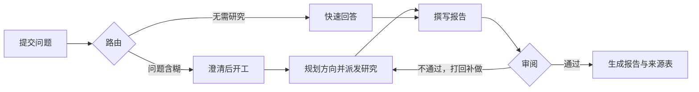

# DeepResearcher

[](https://github.com/Zi-Lan-Cui/deepresearcher/actions/workflows/quality.yml) [](LICENSE) [](pyproject.toml)

可部署的深度研究服务。围绕复杂问题自动完成检索、精读、证据校验与撰写审阅，交付论点明确的研究报告，每条结论都能追到原文核对。

[快速开始](#快速开始) · [运作方式](#运作方式) · [使用](#使用) · [配置](#配置) · [开发](#开发)


## 特性

- **原文追溯**：每条结论均出自原文，并在报告末附上逐字摘录的原文与出处链接，便于复查。
- **异步并行**：子任务完成后结果动态注入，主任务无需等待所有子任务完成即可继续推进。
- **组织清晰**：报告围绕一条核心主张展开，各章节相互呼应，而不是简单堆砌检索结果。
- **状态可见**：研究过程中的每个阶段都会实时更新，用户可以随时查看任务的进展情况。
- **费用可控**：有完善的预算成本控制，研究轮次，证据规模，单方向研究深度均可调节，按需付费。

## 快速开始

用 Docker Compose 可以一键启动。

```bash
git clone https://github.com/Zi-Lan-Cui/deepresearcher.git
cd deepresearcher
cp env/.env.example env/.env   # 填入模型配置 LLM_API_KEY / LLM_BASE_URL / LLM_MODEL_ID，
                               # OpenAI 兼容接口均可。再填至少一个搜索服务：百度 / Tavily / SerpAPI / 阿里云
docker compose up -d --build   # 启动服务，拉起 API、Worker、Postgres、Redis 和 RocketMQ
```

## 配置

完整配置项见 [env/.env.example](env/.env.example)，下面列出最常用的几项：

| 配置项 | 作用 | 必填 | 默认 |
|---|---|---|---|
| `LLM_API_KEY` / `LLM_BASE_URL` / `LLM_MODEL_ID` | 模型服务，OpenAI 兼容接口均可 | 是 | 无 |
| `BAIDU_API_KEY` 或 `TAVILY_API_KEY` 或 `SERPAPI_API_KEY` | 搜索服务，至少配一个 | 是 | 无 |
| `FETCH_PROVIDER_ORDER` | 网页抓取器，支持`aliyun`（需配阿里云凭据）；不填只用本地实现，可能被反爬拦截 | 否 | 空，只走 `direct` |
| `SERVICE_JWT_SECRET` | 登录令牌签名 | 正式部署必填 | 本地可留空，重启后需重新登录 |
| `SERVICE_ROCKETMQ_ENDPOINTS` | 分派消息的接入点，填 proxy 的 gRPC 端口 | 是 | `127.0.0.1:8081` |
| `AGENT_MAX_RESEARCH_ROUNDS` | 研究轮数上限 | 否 | 2 |
| `SERVICE_MAX_CONCURRENT_RUNS_PER_USER` | 单个用户同时进行的研究数 | 否 | 2 |
| `LLM_MAX_TOKENS_PER_RUN` / `LLM_MAX_COST_CNY_PER_RUN` | 单次研究的 token 与花费上限 | 否 | 0，不限制 |
| `SERVICE_RUN_TRACE_RETENTION_DAYS` | 已完成研究的过程数据保留天数，报告不受影响 | 否 | 14 |
| `LANGFUSE_PUBLIC_KEY` / `LANGFUSE_SECRET_KEY` / `LANGFUSE_BASE_URL` | 调用链与耗时观测 | 否 | 缺任一即关闭 |
| `SSRF_ALLOW_PRIVATE_ADDRESSES` | 允许抓取私网地址，供 fake-IP 代理等本地环境使用 | 否 | `false`，私网与保留段默认拦 |
| `FETCH_PROXY` | 网页抓取时使用的代理。留空直连，并显式忽略环境里的 `HTTP_PROXY` | 否 | 空，直连 |

模型花费由内置价表 `src/deepresearcher/pricing.py` 按人民币折算。接入新模型时在表里补一行价格即可。没有价格的模型照常记录用量，成本一栏留空。

## 使用

注册登录后输入问题。问题不够明确时，系统先给出一组澄清选项，回答后开始研究。详情页显示当前阶段、各研究方向的进展与证据池规模。


完成后直接阅读报告、复制或导出 PDF。正文结论后的编号对应文末来源表的一项，点开即见原文摘录：


账户页可按账号设定研究轮数、每轮方向数、单方向深度与证据池规模，并逐日呈现 token 用量与花费，缓存命中与新计算的用量分开显示：


## 运作方式

一次研究请求按以下环节推进。审阅未通过会打回重做，直到通过或达到轮数上限。



研究环节内部，每个方向先检索，再逐篇精读原文，摘出的证据与原文逐字比对通过后才进入证据池。

## 项目结构

```
Dockerfile                应用镜像，API 与 Worker 共用，由 compose 编排
src/deepresearcher/
├── graph.py、nodes/、routing.py   LangGraph 流水线：路由→澄清→规划→写作→审阅
├── state.py              顶层状态：跨节点交接物的类型与合并语义
├── agents/               各角色（supervisor、researcher、writer 等）的工具、状态与子图
├── tools/                出站适配：搜索、抓取、解析、资料存取，只接收数据类型
├── service/              宿主与适配器：HTTP、消费进程、队列、存储与协调、事件分发
├── observability/        事件记录、OTel 引擎与运行日志
├── prompts/              各角色的系统提示词，外置成 Markdown
└── evidence/、reporting/、schemas/   证据模型、引用校验与渲染、数据契约
tests/                    单元与集成测试，运行 make test
scripts/                  不参与 pytest 的手动验证脚本，由 make verify-service 调用
evals/                    基于 DRB RACE 口径的质量评测，见 evals/README.md
docker/、docker-compose.yml         本地依赖与可选的自建观测栈
env/.env.example          全部配置项与注释
```

服务只有一种运行方式。API 受理任务，worker 消费执行，两者的状态只落在数据库，worker 可以随时增减或重启。

## 开发

```bash
make quality          # lint、类型、测试、覆盖率，CI 每次推送跑同一套
make verify-service   # 实际启动 API 与 worker 两个进程做集成验证，不产生模型费用
```

服务层用例需要真实 PostgreSQL 与 Redis：`SERVICE_TEST_DATABASE_URL` 指定前者，缺则跳过（CI 上必须配置，否则直接报错）；Redis 默认连 `127.0.0.1:6379`，起不来时这组用例会失败而不是跳过。RocketMQ 用 `SERVICE_TEST_ROCKETMQ_ENDPOINTS` 指定，缺则整组跳过。

提交前通过 `make quality` 即可

## 贡献

项目处于个人快速迭代期，暂无正式的贡献流程。遇到问题请开 issue，附上复现步骤和 `run_id` 更容易定位。文档和测试的改进可以直接提 PR，合并前需要通过 `make quality`。

## 许可

[MIT](LICENSE) © 2026 Zi-Lan-Cui
